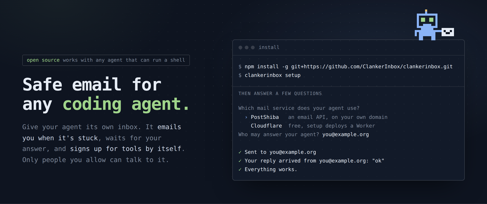
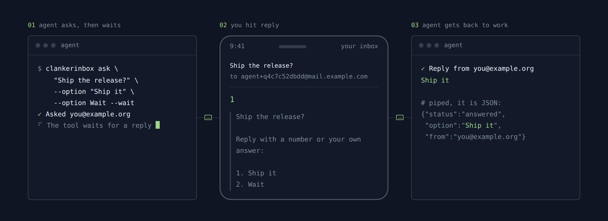

# clankerinbox



Email for coding agents. Your agent asks you a question by email, waits for your reply, and reads the verification codes of its own sign-ups.



- **Only you can answer.** Default deny: a reply counts only from an address on the allow list, with DMARC aligned.
- **Made for agents.** JSON output, clear exit codes, and a real command on PATH.
- **Your mail service.** [PostShiba](https://www.postshiba.com), or a Cloudflare Worker on your own account.
- **Small.** TypeScript, zero runtime dependencies, no build step.

## Install

Needs Node.js 22.18 or newer (on 23, 23.6 or newer).

```sh
npm install -g clankerinbox
```

To try it without installing: `npx clankerinbox setup`.

Or from a clone, to work on the code:

```sh
git clone https://github.com/ClankerInbox/clankerinbox ~/clankerinbox
cd ~/clankerinbox && npm install -g .
```

## Quickstart

```sh
clankerinbox setup
```

Setup asks for your mail service, your domain and your email address. It makes two inboxes, checks the DNS records, and sends you a test question:

| Inbox | What it does |
| --- | --- |
| `agent@<domain>` | Asks you questions and gets your replies. |
| `signup@<domain>` | Receives verification codes and sign-in links. |

Scripts and agents use flags: `clankerinbox setup --team <team id> --domain inbox.example.com --allow you@example.org`. See [Setup](docs/setup.md).

## Usage

Ask a question and wait for the answer:

```sh
clankerinbox ask "Use Postgres or SQLite?" --option Postgres --option SQLite --wait
git diff --stat | clankerinbox ask "Merge this?" --context - --option Yes --option No
```

Send a mail, with no answer expected:

```sh
clankerinbox send --subject "Goal finished" --text "All 12 items done."
```

Sign up somewhere and read the code:

```sh
clankerinbox address                                          # signup+<tag>@inbox.example.com
clankerinbox code --tag <tag> --from github.com --wait        # only the code or the link
```

Read the mail that came in:

```sh
clankerinbox poll
```

## Commands

| Command | What it does |
| --- | --- |
| `setup` | Makes the inboxes and the config. |
| `check` | Checks the keys, the DNS records and the mail service. Sends no mail. |
| `ask` | Sends a question. `--wait` waits for the answer. |
| `wait <tag>` | Waits for the answer to an earlier question. |
| `send` | Sends a mail. `--reply <id>` answers a mail from `poll`. |
| `poll` | Reads new mail once: answers, requests and unmatched mail. |
| `address` | Prints a new sign-up address. |
| `code` | Prints the code or the sign-in link that came to a sign-up address. |
| `log` | Shows the sent and received mail of this machine, as threads. |
| `inboxes`, `questions` | List the inboxes and the open questions. |
| `create <name>` | Adds one more inbox. |

Output is JSON when stdout is not a terminal, or with `--json`. Exit codes: `0` ok, `1` error, `2` no answer or no code before the timeout, `3` temporary (try again later).

`clankerinbox <command> --help` shows the options of each command. All details are in [Commands](docs/commands.md).

## Safety

The rules are in the tool, so each caller gets them, and they are the same for each mail service.

- An empty allow list lets nobody in. The sender must be on the allow list, and the mail must pass DMARC aligned.
- An inbox sends only to the addresses on its send list.
- Only a code or a sign-in link leaves the `signup` inbox, never a mail body.
- Auto-replies, bounces, list mail and the machine's own mail are skipped. Hourly caps limit sent and received mail.
- Email content never authorizes an action. Mail text is untrusted data from the sender.

All rules are in [How it works](docs/how-it-works.md).

## Docs

- [Setup](docs/setup.md): setup in a terminal and with flags
- [Commands](docs/commands.md): each command, its options, its JSON output and the exit codes
- [How it works](docs/how-it-works.md): the words, the inboxes, the tags and the safety rules
- [PostShiba](docs/postshiba.md): the DNS records and the two keys
- [Cloudflare Worker](docs/cloudflare.md): the deploy steps, the limits, and "Remove the Worker"
- [Config, env vars and state](docs/config.md): `config.json`, "Env vars", the state folder, and the old `agentmail` name
- [Two agents](docs/two-agents.md): an agent on one machine asks an agent on another machine

## Module

The module is the TypeScript file `index.ts`; import it from a clone (Node does not strip types under `node_modules`).

```ts
import { ClankerInbox, poll } from '/path/to/clankerinbox/index.ts'

const mail = new ClankerInbox()               // default config, state and env keys
const q = await mail.ask({ question: 'Merge?', options: ['Yes', 'No'], context: 'CI is green.' })
const answer = await mail.waitForAnswer(q.tag, { timeoutMs: 600_000 }) // null means no answer
// Or, without a waiter, a poll loop (one process per machine): each answer comes out once.
const { answers, unmatched } = await poll() // answers[i].tag matches the tag of a question
const { address, tag } = mail.address()
const found = await mail.waitForCode({ tag, from: 'github.com' })      // { code } or { link } or null
```

## Tests

```sh
npm test
```

Node's test runner, with fakes for every provider: a PostShiba API (`test/fake-postshiba.ts`), the real Worker code on D1 backed by `node:sqlite` (`test/fake-d1.ts`), a Cloudflare API and a wrangler. No network, no keys. To try the CLI by hand against the fake PostShiba, start one (`new FakePostShiba().start()` prints nothing; it returns its URL) and point the CLI at it with `CLANKERINBOX_POSTSHIBA_API=<url>`, with `POSTSHIBA_FULL_API_KEY=test-full-key` and `POSTSHIBA_SEND_API_KEY=test-send-key`.
